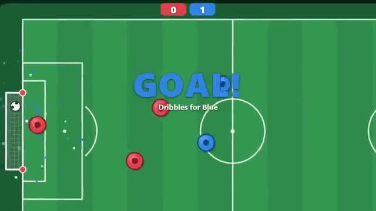

# Pitch Ball

Round players, one ball, hold Kick and score. A multiplayer starter game from [Multiplayer Agent](https://multiplayeragent.com): 2D, versus, 2–8 players, with bots that fill every empty spot on both teams.

## How it plays

Run around the pitch, bump the ball to dribble and hold Kick to shoot it into the far goal. First team to 5, or the leader after 3 minutes; a tie goes to golden goal.

**Controls:** WASD or arrows to run, Space or click to kick · touch: drag to run, hold Kick.

## Make it yours in the Game Builder

Open the [Game Builder](https://multiplayeragent.com), choose **Start from a starter game** and pick Pitch Ball. It opens as version 1 in your studio, ready to play and publish. Then ask for changes, for example:

- Make the ball bigger and bouncier
- Add a speed boost button with a cooldown
- Make it ice hockey on a frozen rink

## Run it yourself

1. Get a free publishable key (`pk_…`) at [multiplayeragent.com](https://multiplayeragent.com).
2. In `index.html`, put it in place of `pk_REPLACE_ME` in the `MP_CONNECT` block.
3. Open `index.html` in a browser. No build step and no server needed.

Without a key it still runs, offline against bots.

## How it is built

- One `index.html`. The comment at the top of the script maps the code and explains the multiplayer.
- **Host-run physics:** One player's browser moves the ball and runs the clock, so everyone sees the same bounce; if it leaves, the next player takes over. Your own touches on the ball are decided on your screen, so a save you see is a save.
- **Bots:** Bots fill every empty spot, so even alone you play 3 against 3. People who join take a bot's spot on the smaller team.
- **Leaderboard:** Most goals, for every player.
- **Live sync:** Every player and the ball move for everyone at once.
- `?attract` runs it offline, bots against bots, with a camera that follows the ball. The preview video is recorded from it.

## License

MIT.
